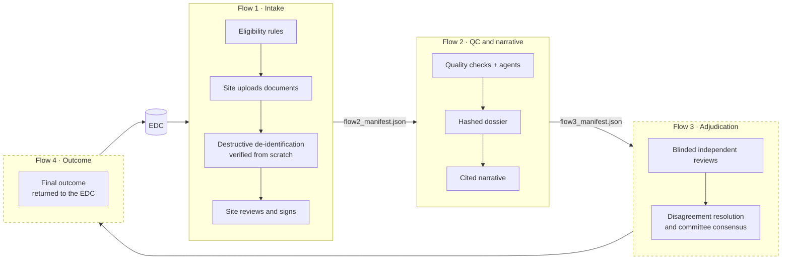
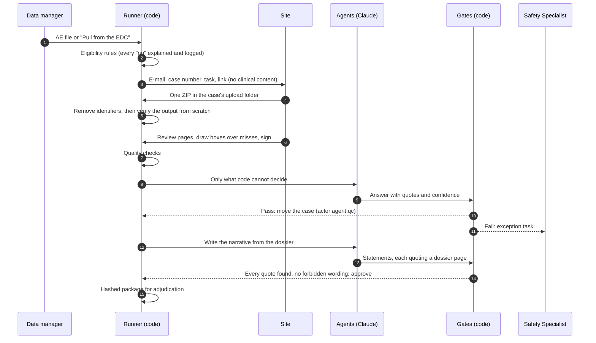
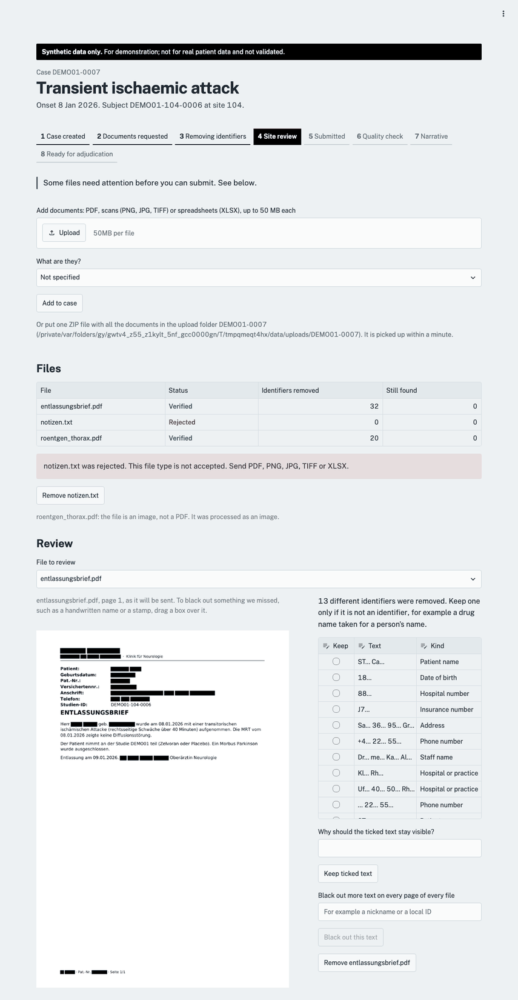
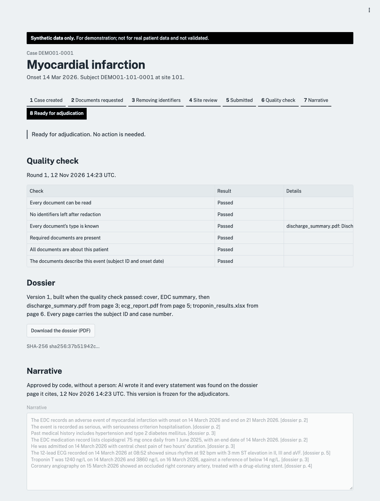
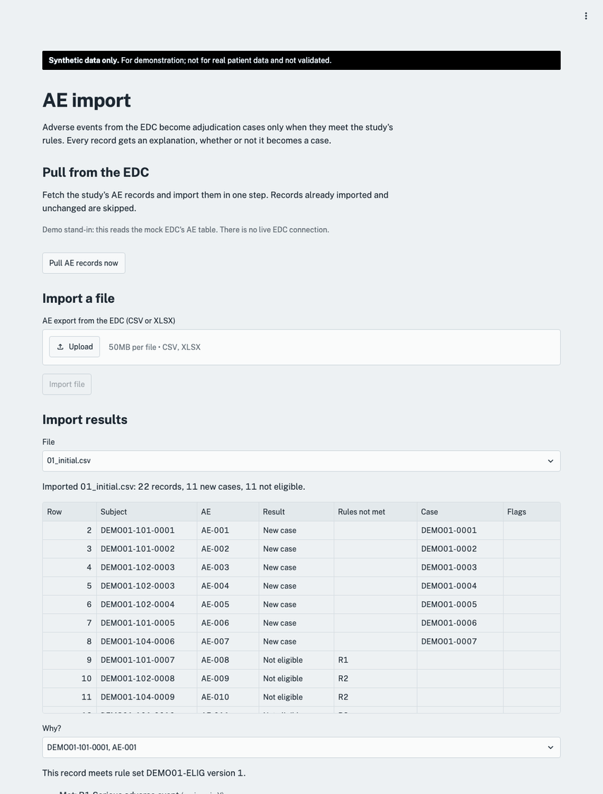
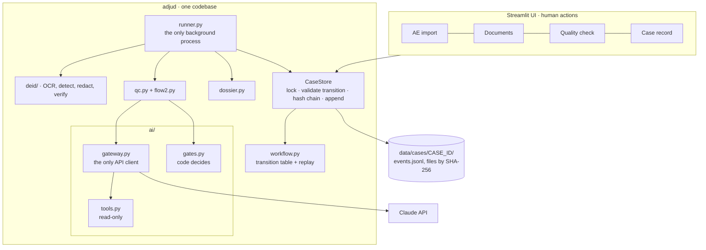

<div align="center">

# Agentic Adjudication

**AI agents prepare clinical-trial adverse events for independent adjudication. Code checks every agent answer, and people sign.**


</div>

> [!WARNING]
> **Synthetic data only.** Every patient, identifier, hospital and drug in this repository is invented. This is a proof of concept. It is not validated, makes no 21 CFR Part 11 or EU Annex 11 claim, and has no real authentication. Never use it with real patient data.

---

## Why

In a clinical trial, serious adverse events (AEs) such as heart attacks, strokes and deaths are confirmed by a **Clinical Events Committee** of independent physicians. Before they can review a case, someone has to:

- decide which AEs need adjudication;
- chase the hospital site for discharge summaries, ECGs and lab results;
- black out every patient identifier;
- check that the package is complete and consistent;
- write a neutral case narrative.

Today this is mostly done by hand, in spreadsheets and e-mail, and it takes days of work per case.

**Agentic Adjudication automates that preparation.** It is built on one rule:

> **Agents do the work. Deterministic code decides whether an agent's answer may move a case. People sign, and handle the exceptions.**

An AI answer never moves a case on its own. It must match its schema, every quote it cites must be found on the page it names, its confidence must reach the study's threshold, and every rule check must pass. Otherwise a person gets a task. The site's submission and every adjudication decision stay human electronic signatures.

## Product vision

The full module covers four flows. This repository implements **Flows 1 and 2** end to end.



| | Flow | Status |
|---|---|---|
| 1 | **Intake:** rule-based case creation, document collection, de-identification, site sign-off | ✅ Built, demonstrated, passes its acceptance kit |
| 2 | **Quality check and narrative:** automatic QC with agents, site queries, dossier, cited narrative | ✅ Built, evaluated live on the Claude API |
| 3 | **Adjudication:** blinded reviews, disagreement and consensus | 🔜 Specified in [docs/spec.md](docs/spec.md) §6.5–6.6 |
| 4 | **Outcome:** derived outcome, EDC export, re-adjudication | 🔜 Specified in [docs/spec.md](docs/spec.md) §6.7–6.8 |

## How a case moves



The step-by-step table, with the trigger, component and actor for each step, is in [docs/process.md](docs/process.md).

## Features

**Intake (Flow 1)**
- Eligibility rules written in YAML and evaluated declaratively (no `eval`). Every AE record is logged with the result of each rule, including the records that don't become cases.
- Idempotent imports. A changed EDC record stores a new snapshot and raises a flag; nothing is withdrawn silently.
- Sites can upload through the UI or drop **one ZIP per case** into an upload folder, which can be OneDrive-synced. Corrupt, encrypted, nested or oversized ZIPs are refused, with a reason.
- **Destructive de-identification** of PDFs, scans, photos and spreadsheets:
  - text is read from both the text layer and 300 dpi OCR (English and German);
  - identifiers are found by Presidio, custom rules and label context;
  - text and pixels are removed and metadata stripped;
  - the output file is then **re-read and checked from scratch**. Any finding left blocks signing.
- A **same-patient check** compares dates of birth and names across documents before redaction.
- In the site review, the site can keep a wrongly blacked-out item (a reason is required) or **drag a box** over anything that was missed.

**Quality check and narrative (Flow 2)**
- Six deterministic checks: readable, no identifiers left, document types, required documents by event type, same patient, and subject ID and onset date.
- **Agents only on what code cannot decide:** the type of a letter with no title, and whether the documents describe this event.
- **Automatic queries** to the site for clear failures, for example a missing ECG, another patient's document, an unreadable scan or a different event.
- A **dossier** in PDF form: cover, EDC summary, then the documents in checklist order, with the subject ID on every page, bookmarks, a page map and a SHA-256.
- A **narrative agent** writes facts-only statements, each quoting a dossier page. Code approves it only if every quote is found and no forbidden wording (causality, relatedness, allocation) is used.
- A versioned, hashed **Flow 3 handoff manifest**. It never lists anything from `documents/original/`.

**Platform**
- An **event-sourced audit trail**: each case's only source of truth is an append-only, hash-chained `events.jsonl`. Any edited line or modified file is detected, and the state is rebuilt by replaying events.
- **One AI gateway** with modes `off`, `replay` and `live`; nothing else in the code calls the API. Agents act only through read-only local tools. Every call is recorded with its prompt version, input hash, tokens, cost and latency, and is subject to a budget cap.
- **Runs with AI off:** every step that needs judgement becomes a human task.
- **Study configuration, not code:** rules, de-identification policy, document checklist, AI switches, thresholds and the narrative template live in `data/config/<STUDY>/`.

## Screenshots

| Site review: redacted pages, draw a box, sign | Quality check: checks, dossier, AI-written narrative |
|---|---|
|  |  |

<details>
<summary>AE import: every record explained</summary>



</details>

## Results

All results are on synthetic data.

**De-identification**, scored by the test kit's own harness on its synthetic corpus with OCR on:

| Document type | Identifiers removed | Clinical content kept |
|---|---|---|
| Text PDFs (English and German) | **41 / 41** | **28 / 28** |
| Spreadsheet (hidden sheet and column, comments, properties) | 8 / 8 | 3 / 3 |
| Scans, image-only, rotated, mixed and mislabelled images | **100% on every variant** (reference tool: 0–40%) | 3 items scored "lost" by the harness's OCR, intact on visual check |
| Encrypted, corrupt and unsupported files | Rejected, no output | — |

**Agents, live on `claude-haiku-5-5`**: 5 full runs over 6 kit cases and 5 QC scenarios:

| | |
|---|---|
| Schema-valid answers | 40 / 40 |
| Cost | **≈ $0.014 per full demo run**, under $0.004 per case |
| Median latency | document type 3 s · event match 5 s · narrative 14 s |
| Repeatability | Document type and event verdicts identical in 5 of 5 runs |
| Autonomy | 4 of 6 kit cases reach adjudication with only the site's signature. One is queried automatically for missing documents; one goes to a person because the agent's confidence on a poor-quality scan was 0.6 |
| Bug found by the evaluation | Citations from scanned pages were not being verified correctly. Fixed: 25 / 25 narratives pass |

How these were measured: `tools/deid_check.py` and `tools/ai_eval.py`, with details in [docs/plan-mvp.md](docs/plan-mvp.md), step 22.

## Quick start

### Docker (recommended)

Tesseract (English and German) and the spaCy model are built into the image.

```bash
cp -n .env.example .env                                                  # optional settings (keeps an existing .env)
docker compose run --rm runner python -m tools.reset_demo --preload    # fresh demo data
docker compose up --build                                               # UI on http://localhost:8501
```

### Local

You need Python 3.12, [uv](https://docs.astral.sh/uv/) and Tesseract (`brew install tesseract tesseract-lang`).

```bash
uv sync
uv run python -m tools.reset_demo --preload
uv run python -m adjud.runner &            # the only background process
uv run streamlit run ui/app.py
```

The roles are simulated in the sidebar: data manager, site user and Safety Specialist. The signature password for the demo is `demo`.

## Configuration

| Setting | Where | Notes |
|---|---|---|
| AI mode | `ai.mode` in `data/config/DEMO01/study.yaml`, or `ADJUD_AI_MODE` in `.env` | `off` (default), `replay` (recorded answers, no API calls) or `live` |
| API key | `ANTHROPIC_API_KEY` in the environment or `.env` | Environment only, never in config or logs. `live` without a key falls back to `off` and says so |
| Model, effort, thresholds, budget, prices | `ai:` in `study.yaml` | Pinned small model by default; minimum gate confidence 0.8 |
| Agent switches | `ai.functions` | `document_type`, `event_match`, `narrative`; `phi_detection` (AI-1) is off by default because it sends **unredacted** synthetic page images |
| E-mail | `SMTP_*` in `.env` | `docker compose --profile mail up` starts Mailpit on http://localhost:8025 |
| Upload folders | `ADJUD_UPLOAD_DIR` | One folder per case waiting for documents |
| Study rules and policies | `data/config/DEMO01/*.yaml` | Eligibility, de-identification policy, document checklist, forbidden narrative wording |

## Architecture



- **No database, no queue.** Each case is a folder. A case's state is replayed from its events and *is* the work queue; `case.json` is only a cache that `tools.rebuild_state` reproduces exactly. Files are written first (temp file and atomic rename), then the event that references them by path and SHA-256. Nothing is ever overwritten.
- **Two writers, one interface.** The UI (human actions) and the runner (automatic steps) both write through `CaseStore`, which locks the case, validates the transition and chains the hash. The store is an interface, so a database can replace it.
- **A stable boundary between flows.** Each flow reads only the hashed manifest written by the one before it.

The production target in [docs/spec.md](docs/spec.md) §8 is FastAPI, PostgreSQL, object storage with immutability locks, a job queue, Entra ID and an isolated de-identification worker. It keeps the same workflow table, gateway and gate contracts.

## Repository layout

```text
adjud/              application package
  store.py          CaseStore: hash-chained logs, files by SHA-256
  workflow.py       states, transition table, replay
  intake.py rules.py edc_pull.py     Flow 1 intake and eligibility
  deid/             OCR, detection, redaction, verification, same-patient check
  documents.py review.py upload_folder.py handoff.py
  qc.py flow2.py dossier.py          Flow 2
  ai/               gateway, tools, gates, functions, versioned prompts
  runner.py mailer.py notify.py
ui/                 Streamlit app and pages
tools/              reset_demo, verify_log, rebuild_state, deid_check, run_corpus,
                    ai_eval, make_flow2_fixtures, simulate_ai, screenshots
tests/              our test suite (deterministic, never calls the API)
data/config/        study configuration and recorded AI answers (committed)
data/flow1-testkit/ synthetic corpus, ground truth, scoring harness, acceptance tests
docs/               process, build plan, specifications, UI design
```

## Development

```bash
uv run pytest                                                          # our tests
uv run python -m pytest -p tests.kit_plugin data/flow1-testkit/tests   # 53 acceptance tests
uv run ruff check . && uv run ruff format --check .                   # lint and format
uv run python -m tools.verify_log                                      # check every hash chain and file
uv run python -m tools.deid_check                                      # de-identification metrics (~45 s)
uv run --env-file .env python -m tools.ai_eval --runs 5                # live agent evaluation (real API calls)
uv run python -m tools.ai_eval --mode replay                           # free dry run on recorded answers
```

- **Tests are deterministic:** seeded fake data, an injected clock, and recorded AI answers.
- **The test kit in `data/flow1-testkit/` is the acceptance test.** It is never edited to make a test pass.
- **Conventions for contributors and coding agents** are in [AGENTS.md](AGENTS.md).

## Documentation

| Document | Contents |
|---|---|
| [docs/process.md](docs/process.md) | Every step of Flows 1 and 2: trigger, component, actor, AI use |
| [docs/plan-mvp.md](docs/plan-mvp.md) | Build plan, autonomy model, decisions log, measured results |
| [docs/mvp-spec.md](docs/mvp-spec.md) | Storage design, Flow 2 states, AI rules |
| [docs/spec.md](docs/spec.md) | Full module specification (Flows 1–4), requirements and production architecture |
| [docs/ui-design-plan.md](docs/ui-design-plan.md) | Visual system and copy rules |

## Compliance and privacy

This repository demonstrates mechanics, not a validated system.

- **Audit trail and signatures:** the hash-chained audit trail and the signing step model what Part 11 / Annex 11 require, but are not validated against them.
- **Roles:** blinding and roles are shown in the UI, not enforced.
- **Before real data:** the system would need IT and privacy review, a restricted production setup, provider data-processing terms, and validation.
- **AI-1** sends unredacted page images to the AI provider. It is for synthetic data only and never replaces the rule-based detectors.
