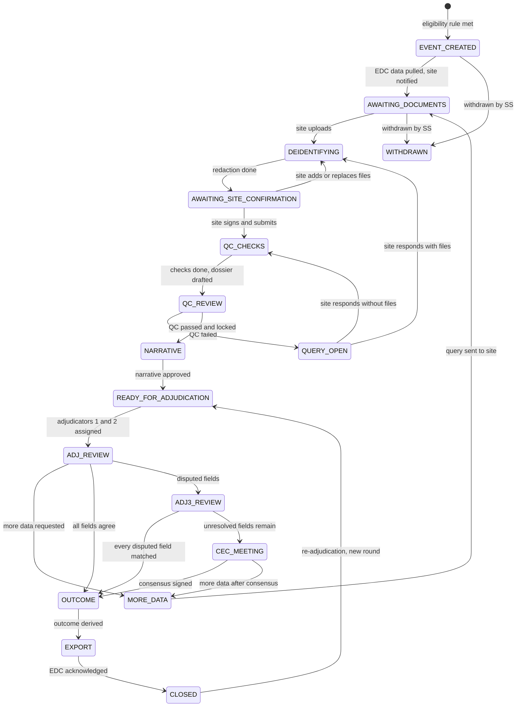
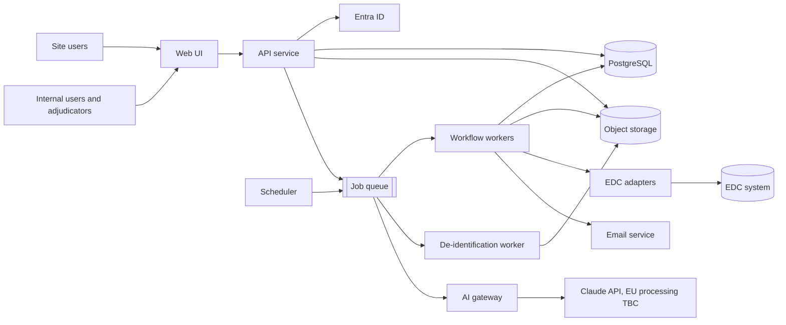
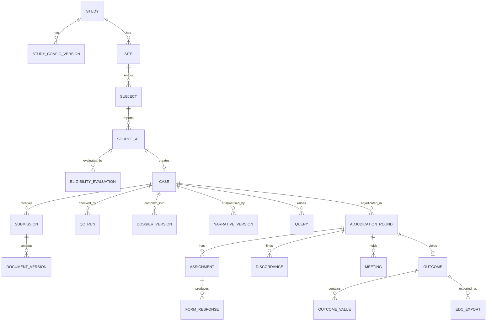

# Clinical Event Adjudication Module — Specification

| | |
|---|---|
| **Document** | spec.md — functional, non-functional and implementation specification |
| **Version** | 0.1 (draft for discussion) |
| **Date** | 5 November 2026 |
| **Status** | Draft. Not approved. Items marked *Proposed* or *TBD* need a decision (see §14) |
| **Sources** | (D) *Adjudication Module — Workflow Overview*, October 2026, slide numbers given as D2, D3 … · (R) review comments from Manisha and Aditi on that deck · (M) technical meeting notes · (P) proposed in this draft |

---

## 1. Purpose

Clinical event adjudication is the independent review of adverse events (AEs) reported by trial sites. Safety specialists check that site data and supporting source documents are complete and consistent, and a Clinical Events Committee (CEC) of independent adjudicators classifies each event against protocol-defined criteria. Today the process relies largely on Excel and email.

This module replaces that with a single system that:

- creates adjudication cases automatically from EDC data using study-specific rules;
- collects and de-identifies supporting documents from sites;
- runs automated and human quality control, and builds the adjudication dossier;
- manages blinded independent reviews, disagreement resolution and committee consensus;
- derives a traceable final outcome and returns it to the EDC;
- keeps a complete audit trail with 21 CFR Part 11 / EU Annex 11 compliant electronic signatures.

The guiding principle (D13): **automation moves the case, people make every decision, AI is optional and only assists.**

## 2. Scope

### 2.1 In scope

- Workflow Flows 1–4 as described in the deck (Intake, Quality control, Independent reviews, Resolving disagreement, Outcome), including the "more data" loops and re-adjudication.
- Study configuration (eligibility rules, forms, checklists, workflow options, notifications, AI switches).
- User and role management, audit trail, electronic signatures.
- Notifications, task management, reports and EDC export.
- Optional AI functions listed in §9.

### 2.2 Out of scope (this version)

- Pharmacovigilance case processing and expedited regulatory reporting (the module only *notifies* the PV function, see OUT-03).
- Randomisation, unblinding and drug supply.
- Acting as the EDC or as the trial master file (TMF). The module exports records for filing.
- Video conferencing for CEC meetings (the module records meetings; it does not host them).

### 2.3 Delivery stages

| Stage | Purpose | Data |
|---|---|---|
| POC | Demonstrate the workflow and the hard technical parts (see §13) | Synthetic only, no real PHI |
| MVP | First validated release for one pilot study | Real study data, validated system |
| Production | Multi-study, full configuration | Real study data |

## 3. Glossary

| Term | Meaning |
|---|---|
| AE / SAE | Adverse event / serious adverse event |
| Case | One adjudication event, from creation to close. Has one or more adjudication rounds |
| CEC | Clinical Events Committee: the independent adjudicators |
| Comparator | The rule used to decide whether two adjudicators' answers to a field agree |
| DICOM | Standard format for medical images (CT, MRI, angiography) |
| Dossier | The compiled, versioned PDF package (plus image studies) that adjudicators review |
| EDC | Electronic data capture system holding the trial's case report forms |
| MedDRA | Medical Dictionary for Regulatory Activities, the standard AE coding dictionary (licensed) |
| Narrative / case summary | Factual written summary of the case given to adjudicators |
| PHI | Protected health information / directly identifying personal data |
| Round | One pass through adjudication (steps 7–11). Re-adjudication creates a new round |
| Safety Specialist (SS) | Internal user who runs QC and approves the dossier and narrative |

## 4. Users, roles and access

### 4.1 Roles

| Role | Who | Main responsibilities |
|---|---|---|
| Site user | Site coordinator or investigator (external) | Upload documents, review redactions, submit, answer queries |
| Safety Specialist | Internal | QC review and sign-off, narrative approval, oversight |
| CEC Coordinator | Internal | Adjudicator assignment, meeting scheduling, re-adjudication start, escalations |
| Adjudicator | CEC member (often external clinicians) | Independent reviews, Adjudicator 3 reviews, committee consensus |
| CEC Chair | Senior CEC member | Chairs meetings, signs consensus (if configured) |
| Medical Coder | Internal (only if in-tool coding is chosen, §6.10) | MedDRA coding |
| Study Administrator | Internal | Study configuration, AI switches (after client approval) |
| System Administrator | Internal IT | Technical administration. **No access to clinical content** |
| Auditor / QA | Internal or sponsor | Read-only access to records and audit trails |
| Sponsor viewer | Client | Reports only, blinding-aware (optional) |

A user can hold different roles on different studies. A full permission matrix is in Appendix A.

### 4.2 Access rules

- **ACC-01 (Must)** Access is role-based *and* study-scoped. Site users see only their own site's cases.
- **ACC-02 (Must)** Adjudicators see only cases assigned to them, and never another adjudicator's answers while their own review is open.
- **ACC-03 (Must)** Treatment allocation is never shown to anyone in the module unless the study configuration explicitly allows it.
- **ACC-04 (Must)** Site users never see adjudication answers, adjudicator identities or committee records.
- **ACC-05 (Must)** System Administrators manage infrastructure without being able to read documents or form contents through the application.
- **ACC-06 (Must)** An adjudicator is never assigned a case from a site they are affiliated with (see ASN-03).

## 5. Workflow and case state model

### 5.1 Principles

1. The case state is stored explicitly in the database. Every change of state happens through one workflow function that checks the transition is allowed, records the audit entry and queues follow-up work, all in one database transaction.
2. **No AI in any handover** (D3). State changes are triggered only by deterministic code (rules, timers, comparisons) or by a signed human action.
3. Long-running work (EDC retrieval, de-identification, QC, dossier building, AI calls, email) runs asynchronously on a job queue. The user interface never waits on it.

### 5.2 States



| State | Meaning | Owner of next action |
|---|---|---|
| EVENT_CREATED | Case created from an eligible AE | System |
| AWAITING_DOCUMENTS | Site asked to upload source documents | Site |
| DEIDENTIFYING | Files being scanned, converted and redacted | System |
| AWAITING_SITE_CONFIRMATION | Site checks redactions before submitting | Site |
| QC_CHECKS | Automated QC checks and dossier draft running | System |
| QC_REVIEW | Safety Specialist reviews QC results and dossier | Safety Specialist |
| QUERY_OPEN | QC failed; query with the site | Site |
| NARRATIVE | Narrative being drafted (AI or manual) and approved | Safety Specialist |
| READY_FOR_ADJUDICATION | Locked dossier and narrative, awaiting assignment | CEC Coordinator / System |
| ADJ_REVIEW | Adjudicators 1 and 2 reviewing independently | Adjudicators |
| ADJ3_REVIEW | Adjudicator 3 reviewing disputed fields only | Adjudicator 3 |
| CEC_MEETING | Committee meeting pending or being recorded | CEC Coordinator / Chair |
| MORE_DATA | Additional information requested from the site | Site |
| OUTCOME | Final outcome being derived and notifications sent | System |
| EXPORT | Outcome being exported to the EDC | System |
| CLOSED | Complete. Can be reopened only by re-adjudication | — |
| WITHDRAWN | Case withdrawn with a reason (e.g. AE deleted in EDC) | — |

### 5.3 Deviations from the deck to confirm

- **More data goes through de-identification first.** The deck sends "more data" straight to Flow 2. New documents still contain PHI, so this draft routes them through upload and redaction (Flow 1) before QC runs again. (Decision D-06.)
- **Re-entry after consensus.** When the committee requests more data after consensus, the deck re-enters Flow 3a, whose first check ("Consensus done?") forwards to Flow 3b, which starts with an Adjudicator 3 task. This draft assumes the case should return to the **CEC meeting** with the updated dossier, not to Adjudicator 3. (Open question Q-06.)
- **Withdrawal.** The deck has no path for an AE that is deleted or changed in the EDC after the case is created. This draft adds WITHDRAWN, always decided by a person (INT-07).

---

## 6. Functional requirements

Priority uses MoSCoW (Must / Should / Could). Source refers to the codes in the header. Requirements in the POC are listed in §13.

### 6.1 Intake and eligibility (Flow 1, step 1)

| ID | Requirement | Priority | Source |
|---|---|---|---|
| INT-01 | The system shall ingest AE records from an EDC through a pluggable adapter: vendor API, read-only database view (SQL Server / Oracle), or file drop. | Must | D4, M |
| INT-02 | The system shall import AE records from CSV/XLSX files using a defined template (§11.2). Invalid files are rejected with a row-level error report; nothing is partially imported. | Must | M |
| INT-03 | An authorised user may enter an event manually with a mandatory reason. Such events are marked `source = MANUAL` and shown as such everywhere. | Should | M |
| INT-04 | Every ingested record is stored as an immutable source snapshot: raw payload, SHA-256 hash, adapter, retrieval time. | Must | P |
| INT-05 | Each record is evaluated against the study's versioned eligibility rule set. The result is stored for **every** record, including non-eligible ones (rule set version, each rule's result, input values), so "no event created" is explainable. | Must | D4, M |
| INT-06 | Ingestion is idempotent. The same source AE (study, subject, EDC AE identifier) never creates a second case. | Must | P |
| INT-07 | Changes to a source AE after case creation are detected, recorded and the eligibility rules re-run. If the event no longer qualifies, the Safety Specialist is alerted and decides to withdraw or continue. The system never withdraws automatically. | Must | P |
| INT-08 | On case creation the system retrieves the related EDC data defined in the study configuration (e.g. demographics, medical history, concomitant medication, relevant labs and procedures). | Must | D4, M |
| INT-09 | On case creation the system searches the subject's history for prior similar events using configurable matching (same MedDRA PT or SOC, configurable date window) and lists them in the case. | Must | M |
| INT-10 | The system flags possible duplicate cases for the same subject (overlapping dates, same or related term) for Safety Specialist review. | Should | P |
| INT-11 | EDC polling interval is configurable per study (default 5 minutes, as in the prototype). Push or webhook triggers are supported where the EDC offers them. | Must | M |

### 6.2 Document upload and de-identification (Flow 1, step 2)

| ID | Requirement | Priority | Source |
|---|---|---|---|
| DOC-01 | Sites can upload PDF, JPG, PNG, TIFF, DOCX, XLSX and DICOM (single files or zipped series). Size limits are configurable (proposed default 200 MB per file, 5 GB per DICOM study). | Must | M |
| DOC-02 | Every file is malware-scanned and its type verified from content (not extension) before any further processing. | Must | P |
| DOC-03 | Original (unredacted) files are kept in a separate quarantine store, readable only by the uploading site and the de-identification worker. Retention of originals follows decision D-08. | Must | P |
| DOC-04 | Deterministic PHI detection runs on all text layers: patterns and named-entity recognition for names, dates of birth, addresses, phone numbers, email, medical record and national ID numbers, and the other identifiers in the study's configured identifier list (including HIPAA Safe Harbor identifiers when US sites take part). | Must | D4, M |
| DOC-05 | Scanned PDFs and images are OCR'd so PHI in the pixel content can be found and redacted. | Must | M |
| DOC-06 | DICOM files are de-identified using the DICOM PS3.15 Annex E Basic Application Level Confidentiality Profile, with study-configurable options (e.g. date shifting). Burned-in pixel annotations are detected and masked. | Must | D4, M |
| DOC-07 | Optional AI-assisted PHI detection in scans and images (AI-1, §9). Its findings are added to, never replace, the deterministic findings. | Could | D4, M |
| DOC-08 | Redaction is **destructive**: underlying text, image pixels and hidden layers are removed, not covered. The output is checked by re-extracting text and re-running detection. Any residual finding blocks submission. | Must | P |
| DOC-09 | All document metadata is stripped (PDF info and XMP, EXIF, Office properties, comments, tracked changes). | Must | P |
| DOC-10 | The site reviews every redaction on screen and can add or remove redactions, with a reason for each removal. All changes are audited. | Must | D4, M |
| DOC-11 | The site confirms and submits with an electronic signature (meaning: *Submitted — documents complete and de-identified*). | Must | D4 |
| DOC-12 | Approved documents get a PDF/A rendition for the dossier. DICOM stays DICOM and is viewable in-browser. | Must | P |
| DOC-13 | Every document version has a version number, SHA-256 hash and lineage (original → redacted → rendition). | Must | P |
| DOC-14 | The subject's study ID (pseudonym) is stamped on each dossier page. | Should | P |
| DOC-15 | On submission the site receives an acknowledgement and the Safety Specialist a "documents received" notice. | Must | R |

### 6.3 Quality control and dossier (Flow 2, steps 3–5)

| ID | Requirement | Priority | Source |
|---|---|---|---|
| QC-01 | QC starts automatically on site submission. | Must | D5 |
| QC-02 | Rule-based checks run on every submission: required-document checklist for the event type, file readability and page counts, residual PHI scan, and consistency of deterministic fields (subject ID, key dates) with the EDC. | Must | D5, D10 |
| QC-03 | Optional AI checks: document type classification (AI-2) and document-to-EDC consistency (AI-3). Results appear as labelled suggestions. | Could | D5, D10 |
| QC-04 | A draft dossier is built automatically: cover page, bookmarked index, EDC data summary, prior similar events, and documents in the study's configured order. Each dossier version is hashed. | Must | D5 |
| QC-05 | The QC form is pre-filled with check results. The Safety Specialist can override any result with a reason. | Must | D5, D10 |
| QC-06 | The Safety Specialist signs QC once. The signature covers the QC form and the specific dossier version (by hash). | Must | D5 |
| QC-07 | If QC fails, a structured query (reason codes plus free text) goes to the site. On the site's response, all checks run again automatically. Query history is kept. | Must | D5 |
| QC-08 | When QC passes, the documents and dossier are locked. Later changes are only possible through the More Data path and create a new dossier version. | Must | D5 |
| QC-09 | Manual oversight: at any time the Safety Specialist can view all automated and AI results, re-run checks, put a case on hold, or take a manual step instead of an automated one. | Must | R |

### 6.4 Narrative / case summary (Flow 2, step 6)

The deck currently shows the case summary as "skipped when AI is off", while step 6 still has the Safety Specialist approving a summary. The reviewers asked for narrative creation as a step. This section resolves it: **every case gets a narrative; AI only drafts it.**

| ID | Requirement | Priority | Source |
|---|---|---|---|
| NAR-01 | Every case has an approved narrative before adjudication, whatever the AI setting. | Must | R, D10 |
| NAR-02 | Optionally, AI drafts a facts-only narrative (AI-4) in which every statement cites a document page or EDC field. | Could | D5 |
| NAR-03 | When AI is off or its draft is rejected, the Safety Specialist writes the narrative in an editor using the study's narrative template. | Must | R |
| NAR-04 | The Safety Specialist approves the narrative with an electronic signature. The approved version is frozen and identical for all adjudicators. | Must | D5, D10 |
| NAR-05 | AI-drafted text stays labelled, and human edits to it are tracked. | Must | D14 |
| NAR-06 | The narrative contains no treatment allocation or other information hidden by the study's blinding configuration. | Must | P |

### 6.5 Adjudicator assignment

| ID | Requirement | Priority | Source |
|---|---|---|---|
| ASN-01 | Per study, assignment can be automatic from the study's adjudicator pool, using round-robin or workload balancing. | Must | R |
| ASN-02 | The CEC Coordinator can assign manually or override an automatic assignment, with a reason. | Must | R |
| ASN-03 | Conflict-of-interest exclusions are enforced: no adjudicator from the case's site or institution, plus any declared conflicts. Country exclusion is configurable. | Must | P |
| ASN-04 | Specialty matching per event type is supported (e.g. cardiologist for MI, neurologist for stroke). | Should | P |
| ASN-05 | Adjudicators 1 and 2 are always different people. Adjudicator 3 differs from both. | Must | D6, D7 |
| ASN-06 | Every task has a due date from the study's service levels, a reminder before it is due, and escalation to the Coordinator when overdue. | Must | P |
| ASN-07 | Reassignment is audited. A new assignee does not see the previous assignee's unsigned draft. | Must | P |
| ASN-08 | Adjudicator unavailability (leave, capacity limits) is respected by automatic assignment. | Should | P |

### 6.6 Adjudication (Flows 3a and 3b, steps 7–10)

| ID | Requirement | Priority | Source |
|---|---|---|---|
| ADJ-01 | Adjudication forms are defined per study and event type as versioned form definitions (§11.4). The form version is fixed for the whole round. | Must | P |
| ADJ-02 | Adjudicators 1 and 2 review in parallel and blinded: neither sees the other's answers, and treatment allocation is hidden. | Must | D6, D11 |
| ADJ-03 | The review workspace shows the dossier, the frozen narrative and (if enabled) the labelled AI summary beside the source documents. AI never proposes answers on the form. | Must | D6 |
| ADJ-04 | Adjudicators can save drafts and submit with an electronic signature (meaning: *Adjudication assessment*). Signed responses cannot be changed. | Must | D6 |
| ADJ-05 | An adjudicator can request more data, specifying what is needed. The case moves to MORE_DATA and the open review tasks pause. When the data arrives, both adjudicators review the updated dossier; any signed response from before is kept as superseded (Q-05). | Must | D6 |
| ADJ-06 | Once both reviews are signed, answers are compared field by field using each field's comparator: exact match, set equality (multi-select), date tolerance, numeric tolerance, or *not compared* (free text). | Must | D6, D11 |
| ADJ-07 | If all compared fields agree, the case goes straight to outcome derivation. | Must | D3, D6 |
| ADJ-08 | If any field disagrees, an Adjudicator 3 task is created for the disputed fields only. Whether Adjudicator 3 sees the earlier answers is a study setting (default: blinded, Q-04). | Must | D7, D11 |
| ADJ-09 | A disputed field is resolved when Adjudicator 3's answer matches Adjudicator 1's or 2's answer. Fields still unresolved go to the CEC meeting. | Must | D7 |
| ADJ-10 | A CEC meeting task is created for the unresolved fields. The meeting record captures date, attendees, quorum check, discussion summary and the decision for each field. | Must | D7 |
| ADJ-11 | If no meeting is recorded by the due date, the task stays open, reminders continue and the Coordinator is alerted. | Must | D7 |
| ADJ-12 | The consensus form is completed and signed by the Chair or by all attendees, as configured per study. | Must | D7 |
| ADJ-13 | The committee can request more data. After the data arrives, the case returns to the CEC meeting (Q-06). | Must | D7 |
| ADJ-14 | Workflow flexibility per study: one or two independent reviewers; whether the Adjudicator 3 step is used or disputes go straight to the committee; which fields are adjudicated and compared; event types that always go to committee (e.g. deaths). | Should | R |

### 6.7 Outcome and export (Flow 4, step 11)

| ID | Requirement | Priority | Source |
|---|---|---|---|
| OUT-01 | The final outcome is derived automatically from agreed, Adjudicator-3-resolved and consensus values. Every final value records which signed form, field and signature it came from. | Must | D8, D12 |
| OUT-02 | The derivation logic is versioned and deterministic; the version used is stored with the outcome. | Must | P |
| OUT-03 | If the outcome meets the study's "related" criterion, a notification goes to the configured recipients (e.g. pharmacovigilance). The exact definition of "related" is confirmed per study (Q-07). | Must | D8 |
| OUT-04 | Case status is set to complete and a completion email is sent. | Must | D8 |
| OUT-05 | Outcome reports are updated. | Must | D8 |
| OUT-06 | The outcome is exported to the EDC through the adapter (or as a file). The EDC's acknowledgement is stored. Failures are retried and alerted, and a reconciliation report lists unacknowledged exports. | Must | D8 |
| OUT-07 | The case closes only after the export is acknowledged (or manually confirmed for file exports). | Must | P |

### 6.8 Re-adjudication

The reviewers asked what "original result kept" means. In this design it means: **re-adjudication never edits or deletes the first result. It adds a new round, and the old outcome remains in the record, marked as superseded.**

| ID | Requirement | Priority | Source |
|---|---|---|---|
| RDJ-01 | Re-adjudication is started manually by an authorised role (CEC Coordinator; confirm whether Safety Specialist too) with a mandatory reason. | Must | D8, D12 |
| RDJ-02 | It creates a new round (n+1) that repeats steps 7–11. If new data is needed, it first goes through the More Data path. | Must | D12 |
| RDJ-03 | All responses, signatures and the outcome of earlier rounds are kept unchanged. The earlier outcome's status becomes SUPERSEDED and links to the new one. | Must | D12, R |
| RDJ-04 | The EDC export of the new outcome is flagged as a correction of the earlier export. | Must | P |
| RDJ-05 | Screens and reports show the current outcome by default, with the history one click away. | Must | P |
| RDJ-06 | The study setting decides whether re-adjudication uses the same or different adjudicators. | Should | P |

### 6.9 Notifications

| ID | Requirement | Priority | Source |
|---|---|---|---|
| NOT-01 | A notification is sent at every workflow step listed in Appendix B, covering at minimum event creation, document upload/submission, document QC and adjudication. | Must | R |
| NOT-02 | Emails contain no PHI or clinical content: only study, case ID, task, due date and a link. | Must | P |
| NOT-03 | An in-app task inbox mirrors all actionable notifications. Email is never the only record of a task. | Must | P |
| NOT-04 | Recipients are configurable per study and role. Users can choose a daily digest for information-only notices. | Should | P |
| NOT-05 | Reminders and escalations follow ASN-06. | Must | P |
| NOT-06 | Notifications are sent from a transactional outbox, delivery status is logged and failures are retried. | Must | P |

### 6.10 Medical coding

The reviewers asked whether medical coding can be done in the tool. It is not in the current design. Two options are proposed (decision D-09):

- **Option A — import:** coded terms come from the EDC, where coding is already done. The module displays them and uses them in eligibility rules. No MedDRA licence needed for the module itself.
- **Option B — in-tool:** a Medical Coder codes the adjudicated event in the module. Requires a MedDRA licence and dictionary version management.

| ID | Requirement | Priority | Source |
|---|---|---|---|
| COD-01 | The module records the MedDRA coding (LLT, PT, SOC, MedDRA version) of the source AE, imported from the EDC (Option A). | Must | R |
| COD-02 | Option B: in-tool coding with hierarchy browse and search (LLT → PT → HLT → HLGT → SOC), version recorded per coded term, and tracked recoding on version upgrades. | Could (TBD) | R |
| COD-03 | Option B: AI suggests candidate codes (AI-5); the coder selects. | Could | P |
| COD-04 | Coding is included in reports and the EDC export where in scope. | Must | P |

### 6.11 Reports

The reviewers asked which reports are available and in which formats. Proposed list, to confirm with them (Q-09):

| ID | Report | Content | Formats | Priority |
|---|---|---|---|---|
| RPT-01 | Case status tracker | All cases, current state, owner, age in state | XLSX, CSV, PDF | Must |
| RPT-02 | Pending tasks and ageing | Open tasks by role and person, overdue items | XLSX, PDF | Must |
| RPT-03 | Outcome listing | Final adjudicated outcomes per study, with source AE data | XLSX, CSV, PDF | Must |
| RPT-04 | Adjudicator agreement | Agreement between Adjudicators 1 and 2 per field and event type (percent agreement, Cohen's kappa); Adjudicator 3 and committee rates | XLSX, PDF | Should |
| RPT-05 | Turnaround times | Time per phase and end-to-end, by study and site | XLSX, PDF | Must |
| RPT-06 | QC query metrics | Queries by site and reason, time to resolve | XLSX, PDF | Should |
| RPT-07 | Re-adjudication log | All re-adjudications, reason, old vs new outcome | XLSX, PDF | Must |
| RPT-08 | Case audit trail | Full human-readable audit trail for a case | PDF | Must |
| RPT-09 | Signature manifest | All signatures on a case: who, when, meaning | PDF | Must |
| RPT-10 | AI usage | AI functions used, model versions, accept/edit/reject rates | XLSX | Should |
| RPT-11 | EDC export reconciliation | Exported vs acknowledged outcomes | XLSX, CSV | Must |
| RPT-12 | Case file export | Locked dossier, narrative, signed forms and outcome, for TMF filing | PDF/A (zip) | Must |

- **RPT-G1 (Must)** Reports respect the user's role, study scope and blinding.
- **RPT-G2 (Must)** Every generated report is stamped with generation time, data cut-off, user and report version.
- **RPT-G3 (Should)** Reports can be scheduled. Scheduled output is placed in a secure location; it is never sent as an email attachment.

### 6.12 Study configuration

| ID | Requirement | Priority | Source |
|---|---|---|---|
| CFG-01 | Each study has a versioned configuration: eligibility rules, EDC mapping, related-data list, document checklist per event type, dossier order, narrative template, form definitions and comparators, workflow options (ADJ-14), service levels, notification matrix, AI switches and adjudicator pool. | Must | P |
| CFG-02 | Configuration changes need a second person's approval and have an effective date. Cases in progress keep the version they started with unless explicitly migrated. | Must | P |
| CFG-03 | Configuration can be exported and imported (YAML/JSON) so it can be tested in a validation environment before production. | Should | P |

### 6.13 Audit trail

| ID | Requirement | Priority | Source |
|---|---|---|---|
| AUD-01 | A computer-generated, time-stamped audit trail records every creation, change and deletion of regulated records: who, what (old and new values), when (UTC) and why (reason where required). | Must | D15 |
| AUD-02 | The audit trail is append-only. No user, including administrators, can change or delete entries. It is kept as long as the records it describes. | Must | D15 |
| AUD-03 | The audit trail is viewable per case and exportable in human-readable form (RPT-08). | Must | D15 |
| AUD-04 | Entries are hash-chained so tampering is detectable. | Should | P |
| AUD-05 | Logins, failed logins, signature attempts, permission changes and configuration changes are also audited. | Must | P |

### 6.14 Electronic signatures

| ID | Requirement | Priority | Source |
|---|---|---|---|
| SIG-01 | Each signature requires two components (user ID and password), re-entered at every signing. This is simpler than the 21 CFR 11.200 continuous-session rule and always compliant. | Must | D15, M |
| SIG-02 | Each signed record shows the signer's printed name, date and time (with time zone) and the meaning of the signature (21 CFR 11.50), on screen and in printouts. | Must | D15 |
| SIG-03 | Signatures are bound to the signed content by hash and cannot be copied or moved to another record (21 CFR 11.70). | Must | D15 |
| SIG-04 | Defined meanings: *Submitted*, *QC approved*, *Narrative approved*, *Adjudication assessment*, *Consensus*, *Re-adjudication initiated*. | Must | P |
| SIG-05 | With single sign-on, signing triggers a fresh authentication (e.g. Entra ID re-authentication prompt). Being logged in is never treated as a signature. The approach is confirmed during validation. | Must | M |
| SIG-06 | Users accept a statement that their electronic signature is the legal equivalent of their handwritten one before first signing. The organisation's certification to the FDA (21 CFR 11.100(c)) is tracked as a go-live prerequisite. | Must | P |

### 6.15 User management

| ID | Requirement | Priority | Source |
|---|---|---|---|
| USR-01 | Users are provisioned with role and study scope, reviewed periodically (proposed quarterly), and deactivated rather than deleted. | Must | M |
| USR-02 | Users cannot receive tasks until their required training for the study is recorded. | Should | P |
| USR-03 | Internal users sign in through Entra ID. External site users and adjudicators sign in through Entra External ID / B2B guest accounts, or a separate identity provider (decision D-05). MFA is required for all users. | Must | M |
| USR-04 | Inactive sessions time out (proposed 30 minutes). | Must | P |

### 6.16 User interface

The meeting proposed a minimal three-page front end with logic in the backend. That is right for the POC. The full requirement set needs more screens; they can share one layout and stay simple.

| Screen | POC | MVP | Users |
|---|---|---|---|
| EDC input (import, eligibility results, created cases) | ✔ | ✔ | SS, Admin |
| Review (case view with documents, QC and narrative) | ✔ | ✔ | SS, Site |
| Results / output (outcome, audit trail, export) | ✔ | ✔ | SS, Coordinator |
| Task inbox | | ✔ | All |
| Upload and redaction review | partial | ✔ | Site |
| Adjudication workspace (form beside documents) | stub | ✔ | Adjudicators |
| Assignment board | | ✔ | Coordinator |
| Meeting and consensus record | | ✔ | Coordinator, Chair |
| Reports | | ✔ | Internal, Sponsor viewer |
| Study configuration | file-based | ✔ | Study Admin |
| User administration and audit viewer | | ✔ | Admin, Auditor |

---

## 7. Non-functional requirements

Numeric targets marked *Proposed* are starting points for discussion, not agreed values. The deck lists capacity, backup and recovery targets as open before production (D16).

### 7.1 Performance and capacity

| ID | Requirement | Target |
|---|---|---|
| NFR-PERF-01 | Screen response for normal operations (95th percentile) | < 2 s *Proposed* |
| NFR-PERF-02 | Automated processing from site submission to "QC ready" for a case of up to 20 files / 300 pages, excluding human waiting time (the meeting estimated about 20 minutes for a full automated pass) | < 30 min p95 *Proposed* |
| NFR-PERF-03 | Eligibility evaluation: a batch of 100 rules × 100 subjects (10,000 evaluations) | < 1 min *Proposed* |
| NFR-PERF-04 | Opening a 500-page dossier in the review workspace | first page < 3 s *Proposed* |
| NFR-CAP-01 | Design basis, to confirm (Q-10): 20 concurrent studies, 2,000 cases per month, 200 concurrent users, 5 TB per year of document and image storage | *TBD* |
| NFR-SCL-01 | Workers scale horizontally; adding worker instances increases throughput without code changes | Must |

### 7.2 Availability, backup and recovery

| ID | Requirement | Target |
|---|---|---|
| NFR-AVL-01 | Availability, excluding announced maintenance | 99.5% monthly *Proposed* |
| NFR-AVL-02 | Planned maintenance announced in advance | 5 business days *Proposed* |
| NFR-BCK-01 | Recovery point objective (maximum data loss) | ≤ 1 hour *Proposed* |
| NFR-BCK-02 | Recovery time objective | ≤ 8 hours *Proposed* |
| NFR-BCK-03 | Backups encrypted and stored in a second EU region; restores tested | Quarterly *Proposed* |

### 7.3 Reliability

- **NFR-REL-01 (Must)** Every job is idempotent and carries an idempotency key; running it twice has the same effect as running it once.
- **NFR-REL-02 (Must)** Failed jobs retry with exponential backoff, then move to a dead-letter queue that raises an alert. No case can silently stall: a watchdog alerts on any case in an automatic state longer than its time limit.
- **NFR-REL-03 (Must)** State changes and the jobs/notifications they trigger are written in the same transaction (transactional outbox), so a crash cannot lose or duplicate a handover.

### 7.4 Security

- **NFR-SEC-01 (Must)** TLS 1.2 or later for all traffic; AES-256 encryption at rest for database, object storage and backups; keys in a managed key vault.
- **NFR-SEC-02 (Must)** Secrets (database credentials, EDC credentials, AI API keys) are held only in the key vault, never in code, images or configuration files.
- **NFR-SEC-03 (Must)** Network segmentation: only the EDC adapter can reach the EDC; only the AI gateway can reach the AI provider; the de-identification worker has no internet access.
- **NFR-SEC-04 (Must)** Application security to OWASP ASVS Level 2; independent penetration test before go-live and after major changes.
- **NFR-SEC-05 (Must)** Least privilege for service accounts; database roles prevent the application from updating or deleting audit trail rows.

### 7.5 Data protection and privacy

- **NFR-PRV-01 (Must)** All data is stored and processed in the EU (D14, D15), including backups and AI processing.
- **NFR-PRV-02 (Must)** Pseudonymised trial data is still personal data under GDPR. Controller/processor roles, a data processing agreement with every sub-processor (hosting, email, AI provider) and a data protection impact assessment (DPIA) are completed before real data is processed.
- **NFR-PRV-03 (Must)** Data minimisation: only data needed for adjudication is pulled from the EDC; originals with PHI are kept only as long as decision D-08 allows.
- **NFR-PRV-04 (Must)** AI-1 (PHI detection) necessarily sends unredacted content to the AI provider. It may only be enabled where the DPA and DPIA cover this and the provider contract guarantees EU processing and no retention or training use.
- **NFR-PRV-05 (Must)** Retention of case records follows the sponsor contract and applicable law (EU CTR trial master file retention of at least 25 years may apply). Logs keep no PHI.

### 7.6 Regulatory compliance and validation

- **NFR-CMP-01 (Must)** 21 CFR Part 11 and EU GMP Annex 11 (audit trail, e-signatures, access control, validation).
- **NFR-CMP-02 (Must)** ICH E6(R3) good clinical practice expectations for computerised systems (data integrity to ALCOA+).
- **NFR-CMP-03 (Must)** Risk-based validation following GAMP 5 (2nd edition); custom application, so expect GAMP Category 5 for the workflow, with configuration items validated per study.
- **NFR-VAL-01 (Must)** Validation deliverables: user requirements (this document, once approved), risk assessment, functional and design specification, traceability matrix, test protocols and evidence, validation report, change control and periodic review.
- **NFR-VAL-02 (Must)** Separate development, test, validation and production environments. Production data never goes to lower environments.

### 7.7 Determinism and reproducibility

- **NFR-DET-01 (Must)** Rules, comparators and outcome derivation are pure deterministic code with versioned configuration. Re-running them on the same inputs always gives the same result, and every result stores the versions used.
- **NFR-DET-02 (Must)** AI functions use fixed model versions and versioned prompts, constrained JSON outputs and narrow answer sets (e.g. enums, yes/no). Low temperature reduces but does not guarantee identical outputs, so variability is **measured** (§12.3) rather than assumed away.
- **NFR-DET-03 (Must)** Every AI input (by hash) and output is stored, so any AI-assisted result can be re-examined later.

### 7.8 Observability

- **NFR-OBS-01 (Must)** Structured logs, metrics and traces (OpenTelemetry) with a correlation ID per case and per job. No PHI in logs or traces.
- **NFR-OBS-02 (Must)** Dashboards and alerts for queue depth, job failures, stalled cases, export failures, email failures and AI error rates.

### 7.9 Usability and accessibility

- **NFR-USE-01 (Should)** WCAG 2.1 AA.
- **NFR-USE-02 (Must)** Current and previous major versions of Edge, Chrome, Firefox and Safari.
- **NFR-USE-03 (Must)** Dates stored in UTC and shown in the user's time zone with the offset; date format unambiguous (ISO 8601 or `DD-MMM-YYYY`).
- **NFR-USE-04 (Should)** English user interface, built ready for translation. Source documents may be in several languages; OCR and AI must cover the study's languages (Q-16).

### 7.10 Maintainability and interoperability

- **NFR-MNT-01 (Must)** Infrastructure as code; reproducible container builds; automated test suite in CI with evidence retained for validation.
- **NFR-MNT-02 (Should)** At least 80% automated test coverage of domain logic (rules, workflow, comparators, outcome derivation).
- **NFR-INT-01 (Must)** Internal and external APIs documented with OpenAPI 3 and versioned.
- **NFR-INT-02 (Must)** New EDC systems are supported by adding an adapter, without changing workflow code.

---

## 8. Architecture

### 8.1 Recommended approach

The meeting discussed Python microservices coordinated by an orchestrator, and a preference for **controlled Python services outside the model, using Claude only for specific tasks**. This draft keeps that preference and proposes a lighter variant to reduce operational and validation effort:

- **A modular backend** (one codebase, clear modules per responsibility: intake, rules, documents, QC, dossier, assignment, adjudication, outcome, notifications, export, reports, audit) deployed as a small number of containers, rather than one service per task.
- **Separate containers only where isolation matters**: the de-identification worker (heavy OCR/DICOM work, no internet access, touches PHI) and the AI gateway (the only component allowed to call the AI provider).
- **The orchestrator is a database-backed state machine** (§5.1), not a separate product. Timers (reminders, polling, escalations) run on a scheduler.

Modules talk through internal function calls and jobs, so any of them can later be split into its own service without changing the workflow. See decision D-01.



### 8.2 Components

| Component | Responsibility | Notes |
|---|---|---|
| Web UI | Screens in §6.16 | Thin client; no business logic |
| API service | Authentication, authorisation, REST API, workflow transitions triggered by users | FastAPI |
| Workflow workers | Eligibility, EDC retrieval, QC checks, dossier build, comparison, outcome derivation, export, notifications, reports | Same codebase as API, different entry point |
| De-identification worker | Malware scan hand-off, conversion, OCR, PHI detection, redaction, verification, DICOM de-identification | Isolated network; only component reading originals besides the uploading site |
| AI gateway | Only path to the AI provider. Applies per-study switches, prompt templates, schema validation, logging, rate limits | Off unless enabled per study and function |
| Scheduler | EDC polling, reminders, escalations, watchdog, scheduled reports | |
| EDC adapters | One per EDC type: file drop, database view, vendor API | §11.1 |
| PostgreSQL | All structured data, workflow state, audit trail, outbox | EU region, point-in-time recovery |
| Object storage | Documents, dossiers, exports. Versioned, encrypted, immutability lock on signed artefacts | Separate quarantine bucket for originals |
| Job queue | Asynchronous jobs | See D-02 |

### 8.3 Proposed technology stack

| Concern | POC | Production (proposed) |
|---|---|---|
| Language | Python 3.12 | Python 3.12 |
| API | FastAPI, Pydantic | Same |
| Database | PostgreSQL 16 (container) | Managed PostgreSQL, EU region |
| Migrations / ORM | SQLAlchemy 2, Alembic | Same |
| Job queue | Redis + RQ or Dramatiq | RabbitMQ or managed equivalent (D-02) |
| Object storage | MinIO | Azure Blob Storage with immutability policies (D-04) |
| PDF handling | PyMuPDF (true redaction), pikepdf | Same |
| OCR | Tesseract | Tesseract or managed OCR in EU region |
| PHI detection | Microsoft Presidio with custom recognisers | Same |
| DICOM | pydicom, pydicom `deid` | Same |
| Office conversion | LibreOffice headless | Same |
| Malware scan | ClamAV | ClamAV or cloud-native scanning |
| Front end | Server-rendered templates + HTMX, or React (D-03) | Same as POC choice |
| Identity | Local test users or Entra ID test tenant | Entra ID + Entra External ID (D-05) |
| Email | Mailpit (captures mail locally) | Microsoft Graph sendMail or SMTP relay |
| AI | Claude API, if keys are approved | Claude with EU processing confirmed (D-07) |
| Deployment | Docker Compose | Azure Container Apps or AKS in EU region (D-04) |
| Observability | Console logs | OpenTelemetry, Azure Monitor |

### 8.4 Why not Kafka (yet)

Kafka was raised because a full flow takes about 20 minutes and checks multiply (100 rules × 10 patients = 1,000 checks). Those volumes are small for any job queue: the real need is **asynchronous, retryable, idempotent jobs**, which RabbitMQ or Redis-based queues provide with far less to operate and validate. Kafka becomes worth it if the module later needs to stream events to many other systems. The job interface (§11.3) hides the queue technology, so switching later is contained.

### 8.5 Orchestration options

| Option | Pros | Cons |
|---|---|---|
| **Database state machine + job queue** (recommended) | Simple, transparent, easy to validate; state and audit in one place | Timers, retries and long waits must be built (scheduler + watchdog) |
| Temporal | Durable long-running workflows, timers and retries built in | Extra infrastructure; workflow history separate from the audit trail; steeper learning curve |
| Camunda / BPMN engine | Visual process models business users can read | Heavier; Java ecosystem; BPMN modelling adds a validation surface |
| Claude agents/skills orchestrating the flow | Fast to prototype | Non-deterministic handovers; conflicts with "no AI in any handover" (D3) and the meeting's determinism concern. Not recommended |

---

## 9. AI functions

### 9.1 Common rules

| ID | Requirement | Priority | Source |
|---|---|---|---|
| AI-G1 | Every AI function is off by default and enabled per study and per function by the Study Administrator, only after the client's approval is recorded (approver, date, scope, evidence). | Must | D14 |
| AI-G2 | Every AI output is labelled as AI in the interface and in stored records, with model ID, model version and prompt version. | Must | D14 |
| AI-G3 | AI never changes a case's state, fills signed form fields, makes QC or adjudication decisions, or signs. | Must | D3, D13 |
| AI-G4 | Outputs must match a JSON schema. On failure the call is retried (maximum 2 retries); if it still fails, the step falls back to the manual path and the user is told. | Must | M |
| AI-G5 | Citations in AI output are verified by code: the cited document and page must exist, and where the page has text, the cited value must be found on it. Unverified findings are marked as such. | Must | P |
| AI-G6 | Each AI finding records the human's response: accepted, edited or rejected, by whom and when. | Must | D14 |
| AI-G7 | All AI calls go through the AI gateway, which holds the API key, enforces switches and logs every call (function, model, prompt version, input hash, output, latency, cost). | Must | M |
| AI-G8 | The full workflow runs with every AI function off. | Must | D14 |
| AI-G9 | Each AI function is validated against a golden test set before it is enabled, and re-validated after any model or prompt change. | Must | D14, M |

### 9.2 Function definitions

| ID | Function | Where | Input | Output (schema-constrained) | Human checkpoint | Fallback when off |
|---|---|---|---|---|---|---|
| AI-1 | Find PHI in scans and images | Flow 1 | Page images and OCR text | List of regions: page, bounding box, PHI category, confidence | Site reviews every redaction (DOC-10) | Deterministic detection + manual redaction |
| AI-2 | Classify document type | Flow 2 | Document text and first-page image | One value from the study's document-type list, confidence, evidence page | SS sees it in QC review | SS classifies manually; checklist is filled by upload labels |
| AI-3 | Check documents against EDC | Flow 2 | Key EDC fields and document text | Per field: EDC value, document value, `consistent` / `inconsistent` / `not_found`, cited page | SS decides in QC review | Deterministic date/ID checks only |
| AI-4 | Draft facts-only narrative | Flow 2 | Locked dossier text, EDC data | Sentences, each with at least one citation; no diagnosis, causality or adjudication wording | SS edits and signs (NAR-04) | SS writes the narrative |
| AI-5 | Suggest MedDRA codes | Coding (Option B only) | Verbatim term, context | Up to 3 candidate LLTs with PT and SOC | Coder selects | Coder searches manually |

### 9.3 Example output schema (AI-3)

```json
{
  "type": "object",
  "required": ["findings"],
  "additionalProperties": false,
  "properties": {
    "findings": {
      "type": "array",
      "items": {
        "type": "object",
        "required": ["field", "edc_value", "document_value", "status", "source"],
        "additionalProperties": false,
        "properties": {
          "field": {
            "enum": ["event_term", "onset_date", "admission_date", "discharge_date", "death_date"]
          },
          "edc_value": { "type": ["string", "null"] },
          "document_value": { "type": ["string", "null"] },
          "status": { "enum": ["consistent", "inconsistent", "not_found"] },
          "source": {
            "type": ["object", "null"],
            "required": ["document_id", "page"],
            "properties": {
              "document_id": { "type": "string" },
              "page": { "type": "integer", "minimum": 1 }
            }
          }
        }
      }
    }
  }
}
```

### 9.4 AI provider

Claude is the intended model. Before any real data is used, confirm with IT and procurement (D-07):

- how API access is obtained (direct Anthropic API or Claude through a cloud provider your organisation already uses);
- that processing happens in the EU and that inputs are not retained or used for training, as the deck states (D14);
- that the contract and DPA cover processing of pseudonymised health data and, for AI-1, unredacted PHI.

Until this is confirmed, the POC uses synthetic data only.

---

## 10. Data model

### 10.1 Modelling rules

1. Signed and regulated records are never updated in place. A change creates a new version; the old one remains.
2. Nothing regulated is hard-deleted. Records are withdrawn or superseded, with a reason.
3. Primary keys are UUIDs. All timestamps are UTC (`timestamptz`).
4. Every document, dossier and signed record stores a SHA-256 hash of its content.
5. Every computed result (eligibility, QC check, comparison, outcome) stores the configuration and code version used.

### 10.2 Core entities



| Entity | Purpose | Key fields |
|---|---|---|
| Study | A clinical study using the module | code, sponsor, status, EU/US flags |
| StudyConfigVersion | Versioned configuration (CFG-01) | version, effective_from, approved_by, content (JSON), hash |
| Site / Subject | Site and pseudonymised subject | site number, subject study ID (no direct identifiers) |
| SourceAE | Immutable snapshot of an AE from the EDC or import | edc_ae_id, adapter, payload (JSON), hash, retrieved_at, superseded_by |
| EligibilityEvaluation | Result of rules for one SourceAE | rule_set_version, per-rule results, eligible (bool), inputs |
| Case | One adjudication case | case number, state, current_round, event type, withdrawn_reason |
| Submission | One site submission | submitted_by, signature_id, sequence number |
| DocumentVersion | A file in one form | kind (original / redacted / rendition), storage key, hash, mime type, pages, parent_id |
| RedactionAnnotation | One redaction region | page, box, category, detector (rule / AI / manual), added_or_removed_by, reason |
| QcRun / QcCheckResult | One QC pass and its checks | rule version, result, AI flag, override, override_reason |
| DossierVersion | Compiled dossier | version, document list, hash, locked_at |
| NarrativeVersion | Narrative text | version, text, citations, ai_generated, signature_id |
| Query | Request to site (QC failure or more data) | reason codes, text, opened_by, response, closed_at |
| AdjudicationRound | One pass of steps 7–11 | round number, reason (initial / re-adjudication), form_definition_version, started_by |
| Assignment | A task for one adjudicator | role (adj1 / adj2 / adj3 / committee), user, assigned_by (auto / user), due_at, status |
| FormResponse | An adjudicator's answers | values (JSON), status (draft / signed / superseded), signature_id |
| Discordance | One disputed field | field, adj1 value, adj2 value, adj3 value, resolution (adj3 / committee) |
| Meeting / ConsensusRecord | Committee meeting and decisions | date, attendees, quorum_met, per-field decisions, signature_ids |
| Outcome | Final result of a round | status (current / superseded), derivation version, supersedes_id |
| OutcomeValue | One final field value | field, value, source (form_response_id or consensus_id, field, signature_id) |
| Signature | One electronic signature | user, meaning, record type and ID, record hash, signed_at, auth method |
| AuditEvent | Append-only audit entry | actor, action, entity, old/new values, reason, at, prev_hash, hash |
| Notification | One notice | template, recipients, channel, status, attempts |
| AiInvocation | One AI call | function, model, model version, prompt version, input hash, output, valid, latency |
| AiFindingReview | Human response to an AI finding | decision (accepted / edited / rejected), by, at |
| EdcExport | One export | payload, correction_of, sent_at, acknowledged_at, status |
| User / RoleAssignment / TrainingRecord | Users, study-scoped roles, training | role, study, valid from/to |

### 10.3 How "original result kept" works in the data

Round 1 produces `Outcome A (status = current)`. When re-adjudication starts, `AdjudicationRound 2` is created. When it finishes, `Outcome B (status = current, supersedes_id = A)` is written and A's status changes to `superseded`. A's values, form responses and signatures are untouched, and `EdcExport` for B is flagged `correction_of = export of A`.

---

## 11. Interfaces

### 11.1 EDC adapter contract

```python
class EdcAdapter(Protocol):
    def fetch_ae_changes(self, study: str, since: datetime) -> list[SourceAERecord]: ...
    def fetch_subject_aes(self, study: str, subject: str) -> list[SourceAERecord]: ...
    def fetch_related_data(self, study: str, subject: str, items: list[str]) -> dict: ...
    def export_outcome(self, export: OutcomeExport) -> ExportReceipt: ...
```

| Adapter | Use |
|---|---|
| FileDropAdapter | CSV/XLSX placed in a watched location; POC default |
| SqlViewAdapter | Read-only views on the EDC reporting database (SQL Server / Oracle) |
| Vendor API adapter | One per EDC product, once the EDC is known (Q-01) |

### 11.2 CSV/XLSX import template (minimum)

| Column | Required | Notes |
|---|---|---|
| study_id, site_id, subject_id | Yes | Subject ID is the study pseudonym |
| ae_id | Yes | Unique per subject in the EDC; used for idempotency |
| ae_term | Yes | Verbatim term |
| llt_code, pt_code, soc_code, meddra_version | If coded | |
| onset_date, end_date | onset yes | ISO 8601 |
| serious, seriousness_criteria | Yes | |
| outcome, severity, relatedness_investigator | Should | |
| last_modified | Yes | Used for change detection (INT-07) |

### 11.3 Jobs

Every job uses one envelope; the queue technology is hidden behind it.

```json
{
  "job_id": "uuid",
  "type": "qc.run",
  "case_id": "uuid",
  "idempotency_key": "qc.run:<case_id>:<submission_seq>",
  "config_version": 7,
  "requested_by": "system | user:<id>",
  "created_at": "2026-11-05T09:30:00Z",
  "attempt": 1
}
```

Job types: `edc.poll`, `eligibility.evaluate`, `case.create`, `edc.fetch_related`, `doc.deidentify`, `doc.render`, `qc.run`, `dossier.build`, `ai.invoke`, `adjudication.compare`, `outcome.derive`, `edc.export`, `notify.send`, `report.generate`, `watchdog.scan`.

### 11.4 Form definitions

Adjudication forms are JSON Schema documents with extra keys for UI layout and comparison, for example:

```json
{
  "form_id": "MACE_MI",
  "version": 2,
  "fields": [
    { "id": "event_confirmed", "type": "enum", "options": ["yes", "no", "insufficient_data"], "comparator": "exact", "required": true },
    { "id": "mi_type", "type": "enum", "options": ["type_1", "type_2", "type_3", "type_4a", "type_4b", "type_5"], "comparator": "exact", "show_if": "event_confirmed == 'yes'" },
    { "id": "event_date", "type": "date", "comparator": { "date_tolerance_days": 0 } },
    { "id": "rationale", "type": "text", "comparator": "none" }
  ]
}
```

### 11.5 External API (summary)

| Endpoint group | Purpose |
|---|---|
| `/studies`, `/studies/{id}/config` | Study set-up and configuration versions |
| `/imports` | Upload CSV/XLSX AE files |
| `/cases`, `/cases/{id}` | Case list, detail, history, audit trail |
| `/cases/{id}/submissions`, `/documents` | Upload, redaction review, submit |
| `/cases/{id}/qc`, `/narrative` | QC review and sign, narrative edit and sign |
| `/tasks` | Task inbox for the current user |
| `/rounds/{id}/assignments`, `/responses` | Assignment and adjudication forms |
| `/rounds/{id}/meetings` | Meeting and consensus |
| `/cases/{id}/readjudicate` | Start re-adjudication |
| `/signatures` | Signing with re-authentication |
| `/reports` | Generate and download reports |

---

## 12. Testing and validation approach

### 12.1 Workflow scenario tests

Each path in the deck becomes an automated end-to-end scenario with expected states, notifications, audit entries and signatures:

1. Not eligible: no case created, evaluation stored.
2. Happy path: all fields agree at first review.
3. QC fails, site resubmits, QC passes.
4. More data requested in Flow 3a.
5. Adjudicator 3 resolves all disputed fields.
6. Adjudicator 3 resolves some; committee resolves the rest.
7. Meeting not held by the due date.
8. More data requested after consensus.
9. Re-adjudication after close, original outcome superseded.
10. Source AE changed or deleted in the EDC after case creation.
11. EDC export fails, retries, then succeeds.
12. Full run with all AI functions off.

### 12.2 De-identification tests

A synthetic corpus (PDFs, scans, Word, Excel, DICOM with burned-in text) seeded with known identifiers. Pass criteria: every seeded identifier removed from extracted text and pixels, no metadata left, and the measured recall of each detector recorded. Missed identifiers are tracked as defects.

### 12.3 AI evaluation

- A golden test set per AI function with expected outputs agreed by subject-matter experts.
- Metrics per function: accuracy / precision / recall as applicable, schema validity rate, citation verification rate.
- **Repeatability**, addressing the meeting's concern about varying outputs: each golden case is run at least 5 times; the rate of identical answers per field is reported, and the function is only enabled if it meets the agreed threshold.
- Re-run on every model or prompt change before the change is released.

### 12.4 Other testing

Unit tests for rules, comparators and derivation; integration tests per adapter; performance tests against §7.1; security testing (§7.4); Part 11 controls tested explicitly in the validation protocol.

---

## 13. Proof of concept

### 13.1 Recommended scope

The meeting did not settle whether the POC covers intake only or the full flow. Recommendation (D-10): **go deep on Flows 1–2 and thin on Flows 3–4.** Intake and QC hold the biggest technical unknowns (EDC data, de-identification, rules, AI), while a thin happy-path adjudication still shows stakeholders the whole case lifecycle.

| Area | In POC | Requirements |
|---|---|---|
| Intake | CSV/XLSX file drop (5-minute poll), eligibility rules, case creation, prior-event lookup, site email | INT-01 (file drop only), INT-02, INT-04 to INT-06, INT-08, INT-09, INT-11 |
| Documents | Upload of PDF and images, OCR, Presidio PHI detection, destructive redaction, verification, site review and submit | DOC-01, DOC-02, DOC-04, DOC-05, DOC-08 to DOC-11, DOC-13, DOC-15 |
| DICOM | Header de-identification only | DOC-06 (partial) |
| QC | Rule checks, dossier build, pre-filled QC form, sign, fail and rerun | QC-01, QC-02, QC-04 to QC-08 |
| Narrative | Manual editor; AI draft if API access approved | NAR-01, NAR-03, NAR-04, optionally NAR-02 |
| Adjudication | Two adjudicators (manual assignment), one form, comparison, agree → outcome; disagreement shown but not resolved in-tool | ADJ-01, ADJ-02, ADJ-04, ADJ-06, ADJ-07 |
| Outcome | Derivation with traceability, outcome CSV | OUT-01, OUT-02 |
| Cross-cutting | Audit trail, simple e-signature with password re-entry, notifications to Mailpit | AUD-01, AUD-02, SIG-01 to SIG-03, NOT-01, NOT-02 |
| AI | AI-2 and AI-3 behind switches, only with approved keys | AI-G1 to AI-G8 |

**POC constraints:** synthetic data only; Docker Compose on one host; local test users or an Entra ID test tenant; three main screens (§6.16); no claim of validated status.

### 13.2 POC success criteria

1. A synthetic AE file produces exactly the expected cases (100% match with the expected-results file), and every non-eligible record shows why.
2. All seeded identifiers in the test corpus are removed, verified by text extraction.
3. A complete case can be followed from import to outcome, with an audit trail and signatures that an auditor can read.
4. Each final outcome value links to the signed form it came from.
5. With AI switched off, the same case completes.
6. With AI switched on, outputs are schema-valid, labelled and logged, and repeatability is measured.

### 13.3 Immediate actions (from the meeting)

- Review the existing prototype and earlier Claude chats; record what can be reused.
- Ask IT whether Claude API keys can be issued and under which terms (D-07).
- Agree the decisions in §14.1 needed to start the POC (D-01 to D-04, D-10).
- Prepare synthetic AE files, test documents and one sample adjudication form.

---

## 14. Decisions and open questions

### 14.1 Decisions to make

| ID | Decision | Proposed | Needed before |
|---|---|---|---|
| D-01 | Microservices vs modular backend | Modular backend; separate de-identification worker and AI gateway (§8.1) | POC |
| D-02 | Queue technology | Redis-based queue for POC; RabbitMQ or managed queue for production; not Kafka for now (§8.4) | POC |
| D-03 | Front-end approach | Server-rendered + HTMX for speed of build, unless the team prefers React | POC |
| D-04 | Hosting | Azure in an EU region (fits Entra ID and Microsoft 365) | MVP |
| D-05 | Identity for external users | Entra External ID / B2B guests | MVP |
| D-06 | More-data documents pass through de-identification before QC | Yes (§5.3) | POC |
| D-07 | AI provider access and terms | Confirm EU processing, no retention, DPA coverage | Any AI use with real data |
| D-08 | Retention of unredacted originals | Keep only until submission plus a short grace period (e.g. 30 days), then purge; site keeps its own originals | MVP |
| D-09 | Medical coding | Option A (import from EDC) for MVP; decide on Option B later | MVP |
| D-10 | POC scope | Deep Flows 1–2, thin Flows 3–4 (§13.1) | POC |

### 14.2 Open questions

| ID | Question | For |
|---|---|---|
| Q-01 | Which EDC system(s), and which access method: API, database views or file exports? | Data management / IT |
| Q-02 | Who writes and approves the eligibility rules per study, and in what format do they exist today? | Safety |
| Q-03 | Who signs the site submission: coordinator or investigator? | Clinical operations |
| Q-04 | Does Adjudicator 3 see Adjudicator 1 and 2 answers? | CEC charter owner |
| Q-05 | When more data is requested mid-review, do both adjudicators restart, or only the one who asked? | CEC charter owner |
| Q-06 | After consensus with more data, does the case return to the committee or to Adjudicator 3? | Safety / CEC |
| Q-07 | What does "Related?" in Flow 4 mean (causality to study drug?), and who receives that notification? | Safety / PV |
| Q-08 | Who may start re-adjudication, and must it use the same adjudicators? | Safety / CEC |
| Q-09 | Which reports are needed and in which format? Is the list in §6.11 complete? | Manisha, Aditi |
| Q-10 | Expected volumes: studies, cases per month, users, document sizes, DICOM share | Business |
| Q-11 | Recovery targets (RPO/RTO) and availability | Business / IT |
| Q-12 | Do US sites take part (HIPAA applies)? | Clinical operations |
| Q-13 | Retention period for case records and where the case file is filed (TMF) | QA / Regulatory |
| Q-14 | Is the CEC meeting held outside the tool and only recorded in it? | CEC |
| Q-15 | How is client approval for AI captured (per study contract, separate form)? | QA / Legal |
| Q-16 | Which languages do source documents come in? | Clinical operations |
| Q-17 | Is email the only notification channel, or also Teams? | Business |

---

## 15. Traceability to review comments

| Comment (slide) | Addressed by |
|---|---|
| Narrative creation (D2) | §6.4, NAR-01 to NAR-06 |
| Manual oversight (D2) | QC-09; AI-G3, AI-G6 |
| Notification required for every step: event creation, document upload, document QC, adjudication (D2) | NOT-01 to NOT-06, DOC-15, Appendix B |
| Re-adjudication (D2) | §6.8, RDJ-01 to RDJ-06 |
| Workflow flexibility (D2) | ADJ-14, CFG-01 |
| Auto / manual assignment of CEC members (D6) | §6.5, ASN-01 to ASN-08 |
| Can medical coding be performed in this tool? (D6) | §6.10, decision D-09 |
| Types of report and format (D12) | §6.11, Q-09 |
| Explain "original result kept" (D12) | §6.8, RDJ-03, §10.3 |

---

## Appendix A — Permission matrix

✔ = allowed · R = read only · — = no access. All permissions are limited to the user's studies (and, for site users, their site).

| Capability | Site | SS | Coord. | Adj. | Chair | Study Admin | Sys Admin | Auditor |
|---|---|---|---|---|---|---|---|---|
| Import AE files / manual event | — | ✔ | — | — | — | ✔ | — | — |
| Upload, redact, submit documents | ✔ | — | — | — | — | — | — | — |
| View redacted documents and dossier | own site | ✔ | ✔ | assigned | assigned | — | — | R |
| QC review and sign | — | ✔ | — | — | — | — | — | R |
| Narrative edit and sign | — | ✔ | — | — | — | — | — | R |
| Assign adjudicators | — | — | ✔ | — | — | — | — | R |
| Complete adjudication form | — | — | — | assigned | assigned | — | — | R (after signing) |
| Record meeting / sign consensus | — | — | ✔ (record) | attendee | ✔ | — | — | R |
| Start re-adjudication | — | Q-08 | ✔ | — | — | — | — | — |
| View outcome | — | ✔ | ✔ | — | ✔ | — | — | R |
| Reports | — | ✔ | ✔ | — | ✔ | ✔ | — | ✔ |
| Study configuration | — | — | — | — | — | ✔ | — | R |
| Enable AI functions | — | — | — | — | — | ✔ (after client approval) | — | R |
| User management | — | — | — | — | — | study roles | accounts | R |
| Audit trail | — | case | case | — | — | study | — | ✔ |

## Appendix B — Notification matrix

All notifications follow NOT-02 (no PHI; link only) and appear in the task inbox.

| Trigger | Recipients | Type |
|---|---|---|
| Case created | Site | Action: upload documents |
| Redaction ready for review | Site | Action: review and submit |
| Submission received | Site (acknowledgement), Safety Specialist | Information |
| QC ready | Safety Specialist | Action: review QC |
| QC failed — query | Site | Action: respond |
| Query response received | Safety Specialist | Information |
| QC passed and locked | Site, Safety Specialist, CEC Coordinator | Information |
| Narrative ready for approval | Safety Specialist | Action: approve |
| Adjudication task assigned | Adjudicator 1 and 2 | Action: review |
| Task due soon / overdue | Assignee; Coordinator when overdue | Reminder / escalation |
| More data requested | Site, Safety Specialist, Coordinator | Action (site) |
| Disagreement — Adjudicator 3 task | Adjudicator 3, Coordinator | Action: review |
| Committee meeting needed | Coordinator, Chair, committee members | Action: schedule and hold |
| Meeting not held by due date | Coordinator, Chair | Escalation |
| Consensus recorded | Safety Specialist, Coordinator | Information |
| Outcome final | Safety Specialist, Coordinator | Information |
| Related outcome | Configured PV / safety recipients | Action per PV process |
| EDC export failed | Safety Specialist, System Administrator | Alert |
| Case complete | Safety Specialist, Coordinator (site optional) | Information |
| Source AE changed after creation | Safety Specialist | Action: decide |
| Re-adjudication started | Coordinator, earlier participants, Safety Specialist | Information |
